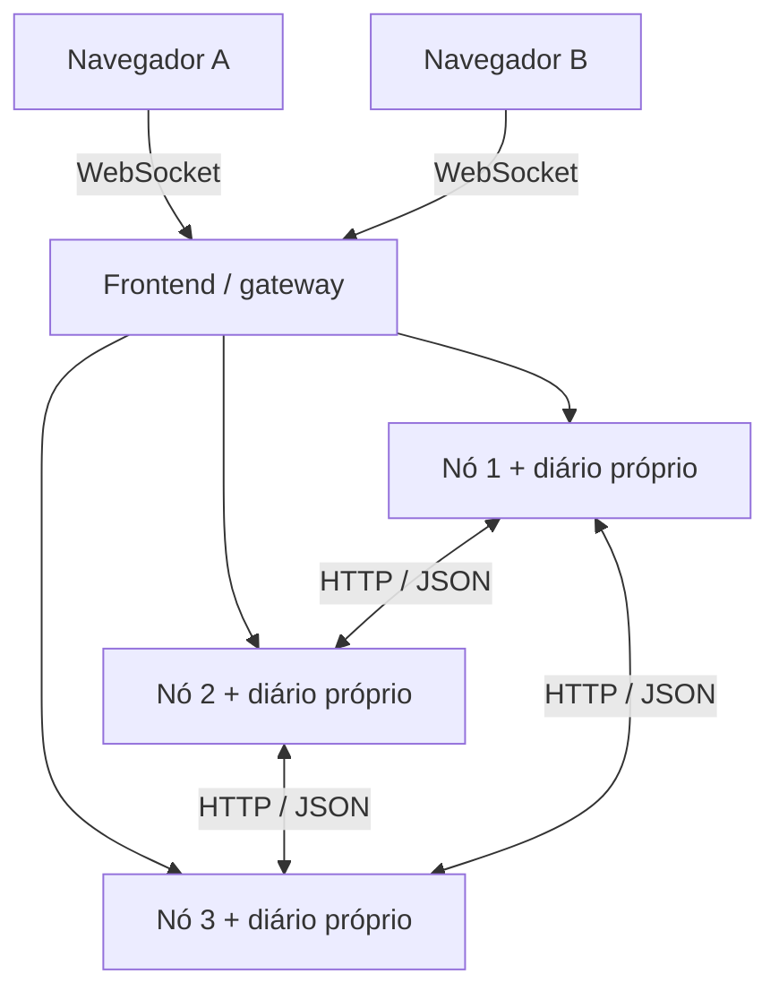

# Neuro — Bar & Truco

**Neuro** é um jogo de truco argentino simplificado para dois jogadores humanos, ambientado em um bar brasileiro em 3D. A experiência começa na porta do bar, passa pelo salão e termina em uma mesa, com cartas, placar e convite por código.

O projeto foi desenvolvido para a disciplina de **Sistemas Distribuídos**. Além do jogo, implementa três servidores que se comunicam, elegem um líder, replicam o estado das partidas e recuperam a execução após a falha de um nó.

## Funcionalidades

- Entrada por apelido, criação de mesa e convite por código.
- Partidas online entre duas sessões de navegador, com turnos validados pelo servidor.
- Distribuição de cartas, resolução de empates, placar até cinco vitórias e revanche.
- Reconexão à mesma mesa, preservando cartas, placar e turno confirmados.
- Cenário em primeira pessoa, caminhada guiada e mesas em perspectiva.
- Quadro de regras e painel técnico acessível pelo banheiro do bar.
- Opções de câmera estável, gráficos leves e cenário ilustrado de contingência.

Os jogadores ao fundo do salão são elementos decorativos. O adversário sentado à sua mesa é outro jogador conectado.

## Tecnologias

| Camada | Tecnologias | Responsabilidade |
| --- | --- | --- |
| Interface | React, TypeScript e CSS | Telas, navegação, cartas e interação com o jogador |
| Cenário 3D | Three.js, React Three Fiber e Drei | Ambiente WebGL, iluminação, objetos e câmera |
| Ferramentas web | Vite | Desenvolvimento da interface e build de produção |
| Servidores | Node.js e TypeScript | Regras autoritativas, sessões, salas e coordenação do cluster |
| Contratos | Zod | Validação das mensagens e das estruturas de dados |
| Comunicação com o navegador | WebSocket, biblioteca `ws` | Comandos e atualizações da partida em tempo real |
| Comunicação entre nós | HTTP com JSON | Heartbeat, eleição, replicação e sincronização |
| Persistência | WAL, SHA-256 e `fsync` | Diários duráveis por nó e verificação da cadeia de operações |
| Infraestrutura | Docker e Docker Compose | Execução dos serviços, rede, descoberta por DNS e volumes |
| Publicação na VPS | Nginx e Certbot | Proxy HTTPS/WSS e certificado do subdomínio |
| Testes | Node Test Runner e Happy DOM | Regras, protocolo, cliente, persistência e cenários de falha |

## Arquitetura

O Compose executa quatro serviços: **três nós de jogo**, usando o mesmo programa, e um **frontend/gateway**, que serve a interface e encaminha as conexões aos nós.



O líder valida e ordena os comandos. Se um navegador estiver conectado a um seguidor, esse nó encaminha o comando ao líder. Antes da confirmação ao jogador, a operação deve ser gravada e aplicada em todos os participantes da configuração ativa, com mínimo de dois nós.

| Mecanismo distribuído | Aplicação no Neuro |
| --- | --- |
| Descoberta por DNS | Os serviços encontram os pares pelos nomes configurados no Compose |
| Heartbeat | Os nós verificam periodicamente a disponibilidade dos pares |
| Eleição Bully | O maior ID apto e disponível pode assumir a liderança |
| Relógios de Lamport | Envios, recebimentos e eventos recebem marcações lógicas |
| Replicação durável | Preparação e decisão são registradas nos diários dos participantes |
| Épocas e recuperação | Uma nova liderança instala um estado comum antes de aceitar comandos |
| Deduplicação | O reenvio do mesmo `commandId` recupera seu resultado sem repetir o efeito |
| Visões privadas | Cada navegador recebe suas cartas e apenas a quantidade de cartas ocultas do adversário |

O painel técnico mostra os dados reais dos processos: líder, disponibilidade, épocas, Lamport, versões, hashes e histórico de eventos. Consulte a [arquitetura detalhada](docs/02-arquitetura.md) e o [protocolo de comunicação](docs/03-protocolo.md).

## Organização do projeto

```text
src/                       Interface React e apresentação
  main.tsx                 Entrada, navegação e integração das telas
  GameTable.tsx            Mesa online, cartas, turnos e placar
  TechnicalPanel.tsx       Painel técnico do cluster
  World3D.tsx              Cenário tridimensional
  scene/                   Layout, câmera e texturas do cenário
  network/                 WebSocket, reconexão e consultas aos nós
  rules.ts                 Hierarquia das cartas e resolução de pardas
server/                    Processos de jogo e gateway
  index.ts                 Servidor HTTP/WebSocket de cada nó
  state.ts                 Estado autoritativo, salas e regras da partida
  cluster.ts               Eleição, Lamport, replicação e recuperação
  storage.ts               Diário persistente e checkpoints
  transport.ts             Transporte HTTP e resolução DNS
  config.ts                Configuração e validação dos pares
  gateway.ts               Interface web e proxy para os nós
shared/                    Contratos compartilhados e schemas Zod
public/cards/              Cartas, catálogo, créditos e licença
tests/                    Testes automatizados e clientes de apoio
scripts/                   Validação, demonstração de falhas e empacotamento
docs/                     Regras, arquitetura, protocolo e registros de validação
compose.yaml               Ambiente de execução e demonstração
compose.production.yaml    Ajustes para operação na VPS
Dockerfile                 Imagens dos nós e do frontend
```

Os diários de teste ficam em `.test-data/` e os relatórios de execução em `.qa/`. Essas pastas são ignoradas pelo Git e pelo Docker. O módulo `src/demo.ts` conserva a simulação original para testes de regressão; a mesa online utiliza o estado enviado pelos servidores.

## Executar com Docker

Requisitos: Docker Engine ou Docker Desktop com contêineres Linux e Docker Compose. Use Git para obter o código:

```bash
git clone https://github.com/KleidsonRocha/TrucoDistribuido.git
cd TrucoDistribuido
```

Na raiz do projeto:

```bash
docker compose up -d --build
docker compose ps
```

Abra **http://127.0.0.1:8080** quando os três serviços `game-*` estiverem `healthy`. Para executar pelo Docker, não é necessário instalar Node.js na máquina hospedeira.

Para conferir o cluster, abra **http://127.0.0.1:8080/#painel** ou consulte os três endpoints:

```bash
curl -fsS http://127.0.0.1:8080/nodes/1/health
curl -fsS http://127.0.0.1:8080/nodes/2/health
curl -fsS http://127.0.0.1:8080/nodes/3/health
```

Confira `ready: true` em todos e o mesmo `leaderId`. Com os três aptos e a eleição estabilizada, o líder esperado é o nó 3. Um HTTP 200 sozinho não indica prontidão. No PowerShell, use `curl.exe` para esses comandos. Se os nós não ficarem prontos, consulte `docker compose logs --tail 40 game-1 game-2 game-3`.

Para jogar:

1. Abra dois navegadores, perfis ou uma janela normal e outra anônima.
2. Entre com os apelidos. Um jogador cria a mesa e compartilha o código da comanda.
3. O segundo entra pelo código ou pela lista de mesas do salão.
4. Os dois confirmam “Estou pronto”. As próximas vazas, mãos e a revanche também exigem confirmação dos dois.

A sessão fica em `sessionStorage`: atualizar a mesma aba permite retomar a mesa. Fechar a aba pode perder a credencial de retomada. Evite duplicar uma aba conectada para criar o segundo jogador, pois o navegador pode copiar seu armazenamento de sessão.

Para desligar os serviços, use `docker compose stop`; para retomá-los, `docker compose up -d`. Os dados dos nós ficam em volumes separados. Remover esses volumes elimina o estado persistido.

## Regras do jogo

A modalidade é **truco argentino simplificado, por vitórias**: baralho espanhol de 40 cartas, três cartas por jogador e até três vazas por mão. Cada mão vencida soma uma vitória; vence quem alcançar cinco. A saída da mão alterna entre os jogadores. Não há envido, flor ou aumentos de aposta.

A hierarquia completa, os empates e a saída de cada vaza estão em [Escopo e regras](docs/01-escopo-regras.md) e no quadro “Como jogar” da interface. O servidor distribui as cartas, valida as jogadas e decide os resultados.

## Desenvolvimento e configuração

Para desenvolver a interface, use **Node.js 24** e npm, mantendo o backend do Compose em execução:

```bash
npm install
npm run dev
```

O Vite informa a URL de desenvolvimento e encaminha as rotas do cluster ao gateway em `http://127.0.0.1:8080`. No PowerShell, use `npm.cmd` se a política de execução bloquear `npm.ps1`. Para uma instalação limpa com versões do lockfile, use `npm ci`, com o servidor de desenvolvimento encerrado.

O ambiente local utiliza os valores do Compose. Para personalizá-los, copie `.env.example` para `.env`.

| Variável | Finalidade |
| --- | --- |
| `APP_PORT` | Porta HTTP publicada pelo gateway; padrão local `8080` |
| `CLUSTER_TOKEN` | Segredo compartilhado para autenticar RPCs entre os nós |
| `PEERS_JSON` | IDs e endereços internos dos três nós, definidos no Compose |
| `HEARTBEAT_INTERVAL_MS` | Intervalo entre verificações de disponibilidade |
| `FAILURE_TIMEOUT_MS` | Prazo para suspeitar da falha de um par |
| `RPC_TIMEOUT_MS` | Timeout de uma chamada entre nós |
| `COORDINATOR_TIMEOUT_MS` | Prazo para aguardar a coordenação de uma eleição |
| `PLAYER_GRACE_MS` | Prazo de retomada após detectar a desconexão de um jogador |
| `ENABLE_TEST_FAULTS` | Habilita pontos de falha controlada; manter `0` no uso normal |
| `NEURO_GATEWAY_URL` | Destino do proxy do Vite quando o gateway usa outra porta |

## Testes e validação

```bash
npm run validate
```

Esse comando executa a checagem de tipos, a suíte automatizada e o build de produção. O relatório fica em `.qa/final-validation.json`.

| Comando | Escopo |
| --- | --- |
| `npm test` | Suíte completa, incluindo regras, cliente, persistência e cluster |
| `npm run test:server` | Estado autoritativo e diário persistente |
| `npm run test:client` | Reconexão do cliente React e reenvio do comando pendente |
| `npm run test:cluster` | Três processos isolados, partida completa e falhas em pontos do protocolo |
| `npm run test:regression` | Regras e regressões do protótipo e do cenário |
| `npm run test:docker` | Demonstração de falha com os contêineres do Neuro em execução |
| `npm run test:production` | Validação da configuração resultante do Compose de produção |
| `npm run build` | Checagem de tipos e compilação da interface |

O teste Docker para e recupera um seguidor e o líder, interrompendo as conexões durante a demonstração. Execute-o sem uma partida importante em andamento. Os testes de cluster usam processos, portas e diários próprios em `.test-data/`.

### Demonstrar recuperação

1. Inicie uma partida em duas sessões e abra `http://127.0.0.1:8080/#painel` em uma terceira aba.
2. Com os três nós prontos e o nó 3 liderando, execute `docker compose stop game-1`. Aguarde a recuperação com dois participantes e continue a partida.
3. Execute `docker compose start game-1`. Aguarde os três nós prontos, com versões e hashes iguais.
4. Execute `docker compose stop game-3`. Observe a eleição do nó 2 e a reconexão dos jogadores. Confira cartas, placar e turno.
5. Execute `docker compose start game-3` e aguarde sua sincronização antes de uma nova demonstração.

Na VPS, utilize o mesmo conjunto de arquivos Compose e variáveis usado para iniciar os serviços. Recupere o primeiro nó antes de parar o seguinte.

## Execução na VPS

A aplicação utiliza o Compose de produção e um proxy HTTPS/WSS administrado no servidor. Configurações de Nginx, certificados e hooks de renovação ficam na VPS.

O repositório mantém os arquivos necessários para executar os serviços:

- [compose.production.yaml](compose.production.yaml): reinício automático, rotação de logs e injeção de falhas desabilitada.
- [.env.production.example](.env.production.example): exemplo de configuração, com porta local `8088` e token a substituir.

Na VPS, copie o exemplo e gere um segredo próprio:

```bash
cp .env.production.example .env.production
openssl rand -hex 32
```

Edite `.env.production` e substitua o valor de `CLUSTER_TOKEN` pelo segredo gerado. Esse arquivo é ignorado pelo Git. Valide a configuração e inicie:

```bash
docker compose --env-file .env.production -f compose.yaml -f compose.production.yaml config -q
docker compose --env-file .env.production -f compose.yaml -f compose.production.yaml up -d --build
docker compose --env-file .env.production -f compose.yaml -f compose.production.yaml ps
```

O proxy da VPS deve encaminhar as requisições ao gateway em `127.0.0.1:8088`, preservando o cabeçalho `Host` e o upgrade WebSocket. O HTTPS termina nesse proxy; a comunicação interna entre os nós utiliza HTTP com token compartilhado.

Para parar um seguidor durante a demonstração e depois recuperá-lo:

```bash
docker compose --env-file .env.production -f compose.yaml -f compose.production.yaml stop game-1
```

```bash
docker compose --env-file .env.production -f compose.yaml -f compose.production.yaml start game-1
```

Aguarde os três nós prontos e sincronizados antes de parar outro. Para testar a queda do líder, consulte seu ID no painel e use o serviço correspondente (`game-3` quando o nó 3 estiver liderando).

## Garantias e limites

A recuperação foi projetada para **uma falha de nó por vez, com os dois sobreviventes conseguindo se comunicar**. Comandos confirmados são preservados nesse modelo. Um nó que retorna sincroniza o estado antes de poder liderar. Bully escolhe o líder e Lamport registra relações causais; a preservação dos comandos depende da replicação durável e da recuperação por épocas.

Partições arbitrárias, perda dos volumes, falha de toda a VPS e comportamento malicioso dos nós ficam fora dessa garantia. O gateway é um serviço único. As credenciais de sessão permitem retomada, sem cadastro de usuário.

O escopo acadêmico limita o conjunto de dados a 20 mesas, 100 identidades e 10 mil comandos deduplicados. O WAL guarda estados completos e ainda não possui compactação ou coleta automática desses registros.

## Documentação e créditos

| Documento | Conteúdo |
| --- | --- |
| [Escopo e regras](docs/01-escopo-regras.md) | Modalidade, hierarquia, turnos e pardas |
| [Arquitetura](docs/02-arquitetura.md) | Componentes, gravação, eleição e recuperação |
| [Protocolo](docs/03-protocolo.md) | Rotas, mensagens, respostas e contratos |
| [Documento de protocolo em PDF](docs/entrega/Neuro-protocolo-entre-nos.pdf) | Formato dos envelopes, payloads, respostas e fluxo dos 14 tipos de RPC interna |
| [Documento de protocolo em Word](docs/entrega/Neuro-protocolo-entre-nos.docx) | Versão editável da especificação entre nós |
| [Fonte do protocolo entre nós](docs/07-protocolo-entre-nos.md) | Especificação em texto para consulta e manutenção |
| [Relatório técnico em PDF](docs/entrega/Neuro-relatorio-tecnico.pdf) | Arquitetura, decisões, algoritmos, análise CAP e testes em seis páginas |
| [Relatório técnico em Word](docs/entrega/Neuro-relatorio-tecnico.docx) | Versão editável do relatório |
| [Fonte do relatório técnico](docs/08-relatorio-tecnico.md) | Versão em texto com referências e limites da validação |
| [Plano de validação](docs/04-plano-validacao.md) | Planejamento e cenários de teste |
| [Registro de verificação da fase 2](docs/05-verificacao.md) | Resultados e limites daquela entrega |
| [Cenário 3D](docs/06-prototipo-3d.md) | Implementação e revisão do cenário |
| [Validação automatizada](scripts/validate.mjs) | Execução de tipos, testes e build com relatório |
| [Roteiro de falhas em PDF](docs/apresentacao/Neuro-roteiro-de-falhas.pdf) | Comandos da VPS e conferência da queda de seguidores e líder |
| [Comandos do roteiro](docs/apresentacao/Roteiro-de-falhas.md) | Versão em texto para consultar e copiar os comandos |
| [Apresentação do Neuro](docs/apresentacao/Neuro-apresentacao.pptx) | Slides editáveis com funcionamento do jogo, tecnologias, arquitetura e notas de fala |

As cartas foram fornecidas no pacote do projeto, com arte de Basquetteur e colaboradores, incluindo Germarquezm, via Wikimedia Commons, e vetorização/distribuição SVG por gjenkins20. Licença: [CC BY-SA 3.0](https://creativecommons.org/licenses/by-sa/3.0/). Os créditos e documentos de origem estão preservados em [public/cards](public/cards/LEIA-ME.md). O cenário é uma criação original inspirada na referência visual enviada para o projeto.
