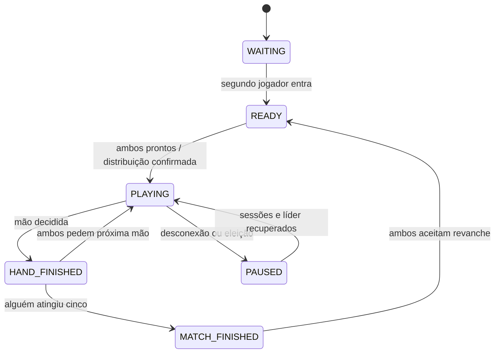

> Regras mantidas na Fase 2. Agora o servidor decide o jogo; o protótipo local citado abaixo é histórico. NEXT_TRICK, NEXT_HAND e REMATCH exigem os dois aceites.

# Escopo e regras · decisão da Fase 1

## Objetivo e limites

Neuro é um trabalho acadêmico de Sistemas Distribuídos ambientado em um bar brasileiro. A versão final mínima terá duas pessoas em navegadores distintos, sem cadastro, usando apelido, sala por código e uma partida de truco argentino simplificado. Cada mão vale uma vitória; a primeira pessoa a atingir **cinco vitórias** vence. Não é melhor de cinco mãos: a partida pode durar até nove mãos.

Sem envido, flor, truco/retruco/vale quatro, aumentos de aposta, dinheiro, ranking, chat, equipes, bot de produção ou múltiplas VPS. O convidado do protótipo serve exclusivamente para revisar telas. Não há requisito de áudio. Desktop é prioritário, mantendo controles utilizáveis no celular.

## Terminologia e cartas

- Partida: sequência de mãos até uma pessoa conquistar cinco vitórias.
- Mão: distribuição de três cartas a cada pessoa, resolvida em no máximo três vazas.
- Vaza: cada pessoa joga uma carta; a maior hierarquia vence, ou ocorre empate (parda).
- Mão de saída: pessoa que abre a mão e tem preferência quando todas as vazas empatam.

40 cartas únicas: números 1–7, 10, 11 e 12, em espadas, bastos (paus), oros (ouros) e copas. O ID usa o nome espanhol e dois dígitos, como `bastos_01`. Não usar 8, 9, coringas ou as imagens da pasta `extras` do pacote.

Hierarquia, da maior para a menor. Todas as cartas da mesma linha têm força idêntica:

| Força | Cartas | Quantidade |
| --- | --- | --- |
| 14 | 1 de espadas | 1 |
| 13 | 1 de bastos | 1 |
| 12 | 7 de espadas | 1 |
| 11 | 7 de oros | 1 |
| 10 | Todos os 3 | 4 |
| 9 | Todos os 2 | 4 |
| 8 | 1 de copas e 1 de oros | 2 |
| 7 | Todos os 12 | 4 |
| 6 | Todos os 11 | 4 |
| 5 | Todos os 10 | 4 |
| 4 | 7 de copas e 7 de bastos | 2 |
| 3 | Todos os 6 | 4 |
| 2 | Todos os 5 | 4 |
| 1 | Todos os 4 | 4 |

O naipe não desempata cartas de uma mesma linha. A soma das quantidades é 40. Referência da hierarquia: [regulamento disponibilizado pelo CASI, seção “Orden de las cartas”](https://www.casi.com.ar/sites/default/files/Reglamento%20Truco.pdf). As simplificações de pontuação e de saída abaixo são decisões do Neuro.

## Distribuição e ordem de jogo

1. A partida começa quando há dois ocupantes e ambos enviam `READY`. No protótipo, “Simular chegada” substitui esse processo.
2. O criador ocupa a posição 0, abre a primeira mão; o convidado ocupa a posição 1. Esta escolha evita sorteio adicional e facilita a apresentação.
3. O líder embaralha as 40 cartas com Fisher–Yates e `crypto.randomInt`, distribui alternadamente três para cada um, começando por quem abre. As outras 34 ficam ocultas e não são usadas nessa mão.
4. Quem abre joga primeiro; a outra pessoa responde. Só pode jogar uma carta que possui e ainda não utilizou. Não há obrigação de acompanhar o naipe.
5. O vencedor da vaza abre a próxima. Se a vaza empatar, quem a abriu mantém a saída. Quem abre uma vaza pode mudar, sem mudar a preferência original da mão.
6. Ao decidir a mão, somar exatamente uma vitória, encerrar vazas restantes e aguardar `NEXT_HAND` dos dois jogadores. Reembaralhar o baralho completo. A saída alterna entre posições 0 e 1 a cada nova mão, independentemente do vencedor.
7. Ao atingir cinco vitórias, bloquear novas cartas e encerrar a partida. Revanche requer aceite dos dois, cria novo `matchId`, zera o placar e faz o criador abrir novamente. Mantém a sala e as posições.

## Resolução completa de pardas

Use A/B para vencedores e E para empate; A pode representar qualquer posição. Parar assim que houver vencedor certo:

| Vaza 1 | Vaza 2 | Vaza 3 | Vencedor da mão |
| --- | --- | --- | --- |
| A | A | Não jogar | A |
| A | E | Não jogar | A |
| E | A | Não jogar | A |
| A | B | A | A |
| A | B | B | B |
| A | B | E | A (ganhou a primeira) |
| E | E | A | A |
| E | E | E | Quem abriu a mão |

A/B são intercambiáveis: a tabela cobre todos os casos, inclusive B/E e E/B. Não contar empate como vitória de vaza para ambos. Não decidir pelo valor numérico impresso da carta. Referência para as pardas: [regulamento publicado pelo Serviço Penitenciário Federal argentino, boletim 3021, seção Truco](https://boletines.spf.gob.ar/PublicSPF/download/BPP_3021.pdf). A política de manter a saída em uma vaza empatada fica explicitamente fixada para o Neuro.

## Estados e interrupções previstos

- Apelido: 2–20 caracteres após `trim`; renderizado como texto, nunca HTML. Apelidos iguais são permitidos; a sessão identifica a pessoa.
- Código final: seis caracteres aleatórios de um alfabeto sem caracteres ambíguos, gerados no servidor, com verificação de colisão. Código não é credencial de reconexão.
- Sala cheia: rejeitar terceiro ocupante. Não há espectadores no mínimo inicial.
- Desconexão de jogador: pausar a partida; reservar posição por 120 segundos. A sessão válida pode retomar nesse prazo. Após o prazo, encerrar como `ABANDONED`, sem inventar uma vitória. Sala de espera expira após 30 minutos sem atividade; ambas as políticas serão executadas pelo líder como comandos replicados.
- Sair explicitamente durante partida: encerrar como `ABANDONED`. Voltar ao salão no protótipo apenas descarta o roteiro local.
- Durante eleição: pausar os comandos de mutação; nenhuma jogada recebe confirmação antecipada. Animações não alteram a autoridade do servidor.
- Uma sessão pode ter uma conexão de jogo ativa: uma nova conexão autenticada substitui a anterior, sem criar novo jogador.

## Interface e privacidade

Entrada → salão → aproximação → espera → partida → resultado. Placar na lousa, código na comanda. Painel técnico separado, sem dados privados do baralho. A fachada, as mesas de madeira, a estrutura metálica das cadeiras e os tons amarelos vêm da referência visual. SVG e CSS oferecem perspectiva e transições curtas com custo viável para o prazo.

Ajuste visual solicitado na revisão: percurso em primeira pessoa, com identificação na porta, abertura da porta e caminhada com balanço até o salão. Mesas ao fundo apresentam jogadores e partidas ilustrativas; as livres estão em primeiro plano. O quadro cinza com escrita de giz abre as regras. A porta do banheiro leva a uma sala separada com azulejos, onde o painel técnico aparece num quadro de manutenção. O retorno ao salão tem controle próprio. Balanço e movimento ambiente podem ser desativados por “Câmera estável” ou pela preferência de movimento reduzido do sistema. A navegação é por pontos clicáveis, sem exigir controles de jogo 3D.

Revisão posterior aprovada: o cenário padrão agora é modelado em 3D real com Three.js/React Three Fiber, substituindo o SVG como ambientação principal. O percurso continua guiado e os controles permanecem em HTML. A versão ilustrada fica como alternativa explícita quando o WebGL não puder iniciar. Detalhes no [documento do protótipo 3D](06-prototipo-3d.md). Isso não avança para a Fase 2.

O navegador recebe as próprias cartas, quantidade de cartas restantes do adversário e cartas já jogadas. Não recebe deck completo, semente, mão oculta do adversário ou tokens de outras sessões. O líder aplica as regras e projeta uma visão por destinatário; seguir essa regra também após reconexão. Os servidores internos mantêm estado completo, portanto são confiáveis dentro da rede privada do Compose.

No protótipo, o roteiro e as cartas de demonstração são públicos no bundle. Isso não será reutilizado como mecanismo de sigilo na Fase 2.
