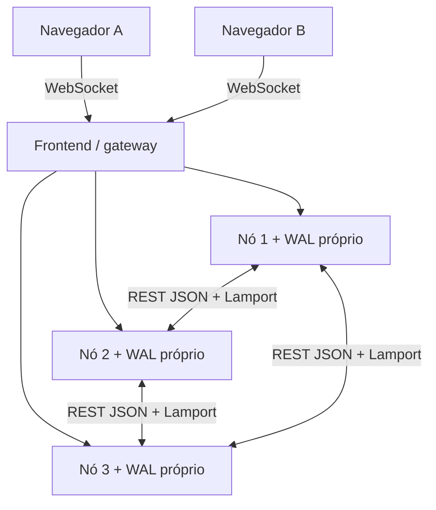

# Arquitetura implementada · Fase 2

## Componentes

Três serviços `game-1`, `game-2`, `game-3` executam o mesmo `server/index.ts` em Node 24. Identidade, portas, pares e tempos vêm de variáveis de ambiente. O DNS interno do Docker resolve os nomes de serviço. Cada nó tem seu próprio volume e diário. O quarto serviço serve React/Vite compilado e encaminha rotas públicas para qualquer nó. Não há banco central substituindo réplicas.

As consultas DNS do transporte são assíncronas, têm timeout curto e cache de três segundos; uma consulta pendente por nome. Isso evita que a resolução de um serviço parado bloqueie os workers de resolução dos sobreviventes. A rede Compose usa IPv4; o endereço é descoberto, não escrito no programa. Uma resposta DNS em cache pode causar uma tentativa falha se o IP mudar; novas consultas renovam o destino.

## Autoridade e fluxo de comando

1. O navegador se identifica com UUID e segredo aleatório de 32 bytes. O segredo só trafega no HELLO; o estado persistente contém seu SHA-256. É uma credencial de retomada, não uma conta de usuário.
2. Um comando possui UUID, sala e versão global esperada. O nó conectado encaminha ao líder caso seja seguidor.
3. O líder processa mutações em uma fila única. Valida contexto, fase, turno e carta. O embaralhamento usa `crypto.randomInt`; o estado proposto já contém o baralho e ambas as mãos.
4. `PREPARE` grava a proposta com índice, época, hash anterior e conjunto de participantes em todos os membros da configuração. Cada gravação termina em `fsync` antes do recibo.
5. Com todos os recibos, o líder grava `DECIDE` localmente e envia aos seguidores. Todos precisam aplicar e gravar antes da confirmação ao jogador. Configurações exigem pelo menos dois nós.
6. `PUBLISH` libera a visão privada aos navegadores. O líder devolve `ACK` com resultado histórico e visão atual do próprio jogador. A conclusão do ACK exige os recibos de aplicação de todos os participantes. Uma falha na publicação pode ser reparada pelo heartbeat ou reconexão.

O ACK retornado por um seguidor também exige a confirmação do líder. Um nó não publica uma preparação pendente. O indicador do painel distingue índice aplicado e publicado. A versão é global, não por sala; uma alteração em outra sala pode tornar um comando obsoleto. Esse comando recebe rejeição terminal `STALE_VERSION`; nova tentativa deve partir de uma ação explícita do usuário.

## Eleição Bully, heartbeat e barreira de época

Cada nó consulta os outros por heartbeat (padrão 1 segundo). Sem contato por 4 segundos, o processo é suspeito. Um nó apto envia ELECTION aos IDs maiores. Quem recebe responde se está apto e concorre; quem não recebe aceite de ID superior tenta coordenar. Assim, o maior ID apto disponível lidera. Os tempos são detectores locais, não prova de morte em redes arbitrárias.

Antes de servir, o candidato coleta snapshots de pelo menos dois nós aptos e anuncia COORDINATOR. Congela os participantes com FREEZE e uma época crescente `(contador, ID do líder)`. A promessa de época é durável e impede aceitar PREPARE/DECIDE de épocas antigas. O congelamento entra na mesma fila das mutações: as operações anteriores terminam ou deixam evidências recuperáveis antes do snapshot da barreira.

O candidato reconcilia os checkpoints, instala uma base comum com o novo conjunto de membros e só depois anuncia LEADER_READY. Durante essa janela os sockets são fechados com aviso de recuperação. A interface reconecta e preserva seu comando pendente.

Se um nó não participou da primeira eleição, ele não fica preso esperando: procura o líder instalado e solicita JOIN. No retorno de um nó parado, JOIN/SYNC_COPY copia e grava o estado antes de marcá-lo apto. A admissão exige nova barreira/configuração. Um nó de maior ID que retorna só concorre depois dessa sincronização.

## Recuperação e deduplicação

O WAL `journal.ndjson` contém registros de relógio, promessa, preparo, decisão e instalação. Cada linha tem checksum; uma cauda incompleta é truncada ao reiniciar. Corrupção em um registro completo impede inicialização em vez de zerar a partida. O checkpoint contém estado, cadeia de hashes e certificado da decisão (lista de participantes que prepararam). Esse certificado é evidência no modelo de nós confiáveis; não é assinatura criptográfica contra nós maliciosos.

Na reconciliação, usam-se primeiro os checkpoints da **maior época instalada**. Entre eles, escolhe-se a maior decisão válida e confere-se a cadeia comum. Preparações sem decisão são descartadas na instalação. Uma decisão vista por um sobrevivente pode ser recuperada mesmo que seu ACK não tenha chegado ao jogador. Se uma decisão só existia no líder que caiu e os sobreviventes a abandonaram numa época nova, o líder antigo não pode ressuscitá-la ao voltar.

Um ACK já devolvido pressupõe aplicação durável em todos os participantes, portanto os dois sobreviventes preservam o comando no modelo de uma falha por vez. O estado recuperado inclui baralho, cartas usadas/restantes, turno, flags de confirmação, placar, identidade e deduplicação. Não se embaralha novamente para recuperar.

A chave de deduplicação é `(hash do segredo, commandId)`. Guardam-se digest do comando e seu resultado no mesmo estado replicado. Repetição idêntica devolve o mesmo resultado histórico junto à visão atual; ID reaproveitado com outro conteúdo é rejeitado. O cliente mantém a mensagem exata no `sessionStorage`, gira pelos três endpoints e a reenvia após WELCOME. Timeout de ACK força nova conexão, conservando ID e versão original. Rejeição terminal encerra o pendente; não se cria outro ID silenciosamente.

## Presença e privacidade

Cada nó informa hashes das sessões com socket ativo no heartbeat. O líder replica mudanças de presença. Sem os dois jogadores presentes a partida pausa; há 120 segundos para retomar a mesma sessão. Após esse prazo, a sala fica abandonada. Salas em espera expiram após 30 minutos. Sair explicitamente encerra a mesa para ambos.

A projeção pública contém somente cartas restantes do próprio jogador, cartas já jogadas, número de cartas ocultas do adversário, placar e metadados de jogo. Painel/status não incluem mãos nem segredos. Snapshots completos só trafegam na rede interna, em RPC com token compartilhado. A mesma credencial em dois lugares controla a mesma identidade; não há uma exclusão global de sockets por identidade.

## Garantias e limites

A garantia é de uma falha de processo por vez, com dois sobreviventes comunicando-se, disco preservado e nós confiáveis. Bully e Lamport sozinhos não fornecem essa garantia: os recibos duráveis, as épocas e a recuperação são essenciais. Lamport obedece `max(local, recebido)+1` na recepção e incremento em envio/evento; não mede tempo físico nem é consenso.

Não há promessa de funcionamento sob partições arbitrárias, dois nós simultaneamente indisponíveis, falha de toda a VPS, perda/corrupção dos volumes ou ataque bizantino. O frontend/gateway é único. HTTP interno com token não é TLS mútuo. A aplicação local usa HTTP/WS; domínio e HTTPS/WSS serão preparados na Fase 3.

Limites deliberados: 20 salas, 100 identidades, 10 mil comandos deduplicados, sem coleta dessas identidades/deduplicação e sem compactação do WAL. O diário guarda estados completos e o relógio também é durável; cresce mesmo com heartbeat ocioso. Esta versão é um demonstrador acadêmico pequeno, não infraestrutura pública dimensionada.
